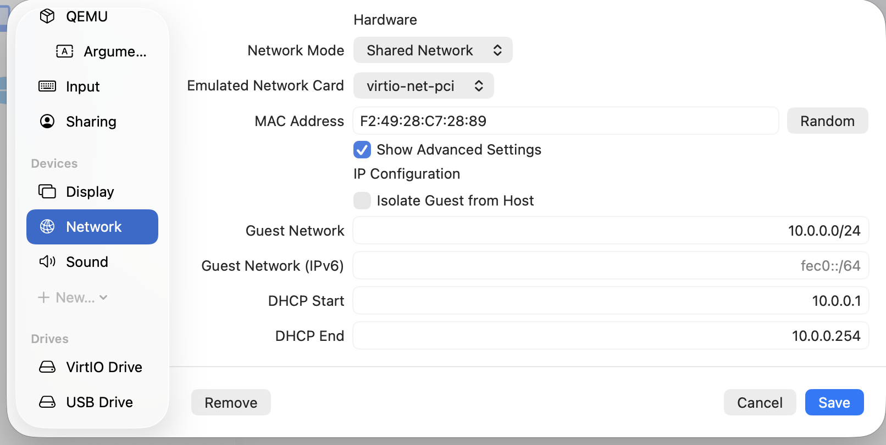
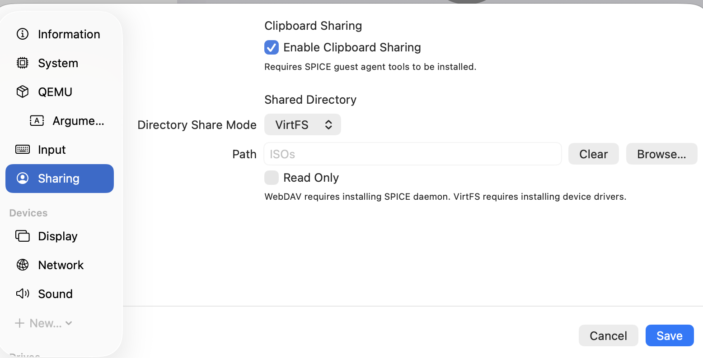
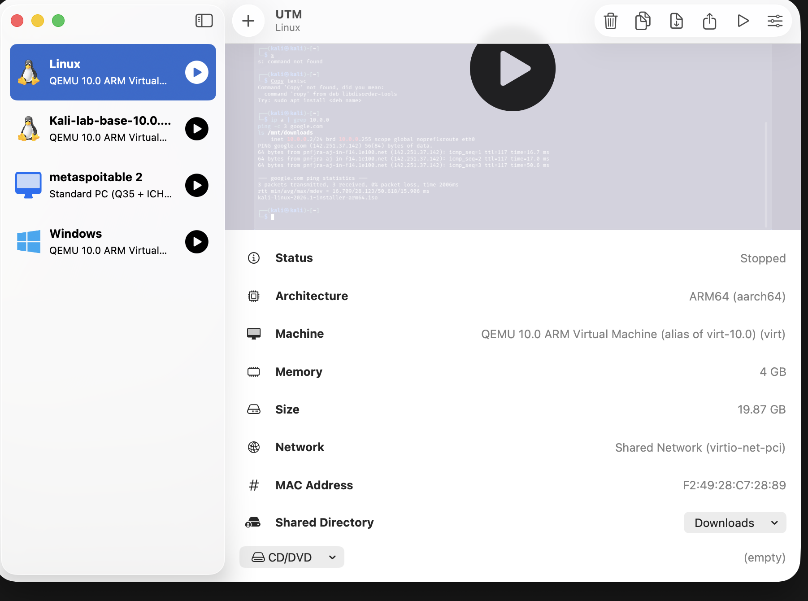
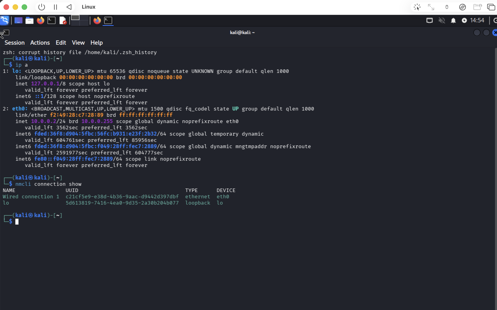
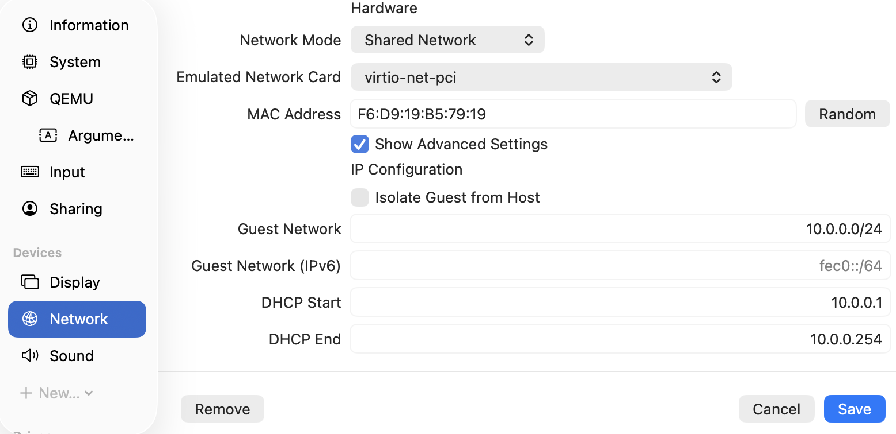
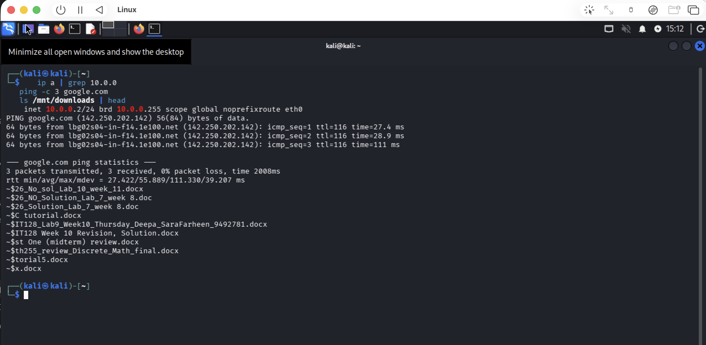
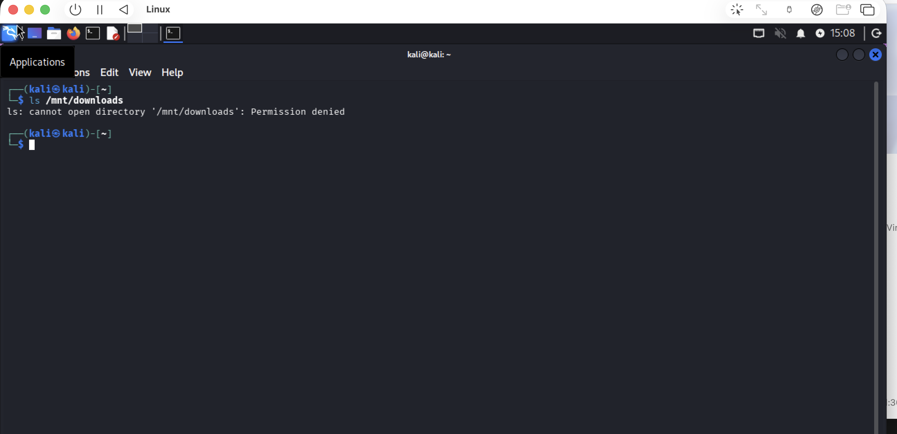
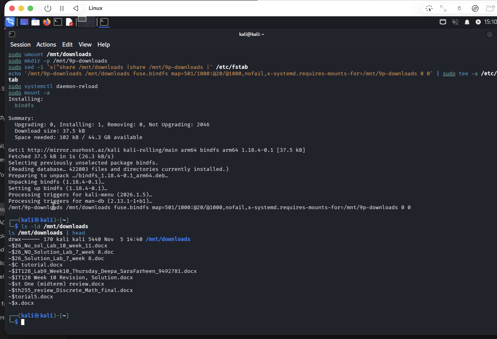

<div align="center">

# 🔐 Cybersecurity Lab Environment Setup

**Building an isolated virtual lab for penetration testing and ethical hacking practice**


-0a66c2)


</div>

---

## 📌 Project Overview

This project sets up a **virtual cybersecurity and penetration-testing lab** with Kali Linux as the attacker machine.

The lab runs on a private NAT network (`10.0.0.0/24`), so target machines (Windows, Metasploitable, Android) can be added later and attacked safely, without touching any real network.

**Task:** WK1-PM1 – Week 1, Project Module 1 (Networkwalks Cybersecurity Program, Batch B084)

---

## 🖥️ Lab Environment

| Item | Value |
|---|---|
| Host OS | macOS (Apple Silicon / ARM) |
| Hypervisor | UTM (QEMU 10.0 backend) |
| Attacker VM | Kali Linux 2026.1 ARM64 (aarch64) |
| VM resources | 4 GB RAM, ~20 GB disk |
| Network mode | Shared Network (NAT), virtio-net-pci |
| Subnet | 10.0.0.0/24 |
| Gateway | 10.0.0.1 |
| Kali IP | 10.0.0.2/24 (static) |

> **Why UTM instead of VirtualBox?** My laptop is an Apple Silicon Mac. UTM runs ARM VMs natively on it, so I used UTM and mapped every VirtualBox requirement to its UTM equivalent.

| VirtualBox requirement | UTM equivalent used |
|---|---|
| NATNetwork 10.0.0.0/24 | Shared Network with custom Guest Network 10.0.0.0/24 |
| Shared Clipboard | Clipboard Sharing + `spice-vdagent` in Kali |
| Drag & Drop | Not supported by UTM for Linux guests → shared folder used instead |
| Shared Folders (Downloads) | Directory Share (VirtFS), mounted at `/mnt/downloads` |
| Snapshot | VM Clone (`Kali-lab-base-10.0.0.2`) |

---

## ✅ Requirements Checklist

| # | Requirement | Status |
|---|---|---|
| 1 | Hypervisor as base (VirtualBox → UTM on Apple Silicon) | ✅ Equivalent |
| 2 | Kali Linux as attacking machine | ✅ Done |
| 3 | Network in subnet 10.0.0.0/24 | ✅ Done |
| 4 | NAT network with 10.0.0.0/24 | ✅ Done |
| 5 | Clipboard enabled | ✅ Done (tested both ways) |
| 6 | File drag/drop | ⚠️ Not supported in UTM → shared folder used |
| 7 | Host Downloads folder shared | ✅ Done |
| 8 | Kali IP 10.0.0.2/24 | ✅ Done (static, survives reboot) |
| 9 | Full internet access | ✅ Done (0% packet loss) |
| 10 | Snapshot / backup of VM | ✅ Done (clone) |

---

## 🛠️ Step-by-Step Setup

### Step 1 – Configure the NAT network (UTM → Kali VM → Edit → Network)

- Network Mode: **Shared Network**
- Show Advanced Settings: **on**
- Guest Network: **10.0.0.0/24**
- DHCP Start: **10.0.0.1** (becomes the gateway), DHCP End: **10.0.0.254**



### Step 2 – Enable clipboard and shared folder (UTM → Edit → Sharing)

- Enable Clipboard Sharing: **on**
- Directory Share Mode: **VirtFS**
- Shared directory: Mac **Downloads** folder



*The path in this screenshot still shows an earlier folder (ISOs); it was then changed to Downloads, shown below.*



### Step 3 – Set the static IP 10.0.0.2/24

After boot, Kali got `10.0.0.2` from DHCP (marked `dynamic`), so I set it manually:



```bash
sudo nmcli connection modify "Wired connection 1" \
  ipv4.method manual \
  ipv4.addresses 10.0.0.2/24 \
  ipv4.gateway 10.0.0.1 \
  ipv4.dns 8.8.8.8 \
  ipv4.dad-timeout 0
sudo nmcli connection down "Wired connection 1"
sudo nmcli connection up "Wired connection 1"
```

### Step 4 – Install the clipboard agent

```bash
sudo apt update && sudo apt install -y spice-vdagent
```

### Step 5 – Mount the shared Downloads folder

```bash
sudo apt install -y bindfs
sudo mkdir -p /mnt/9p-downloads /mnt/downloads

# raw VirtFS share
echo 'share /mnt/9p-downloads 9p trans=virtio,version=9p2000.L,rw,_netdev,nofail 0 0' | sudo tee -a /etc/fstab

# remap Mac user (UID 501) to Kali user (UID 1000)
echo '/mnt/9p-downloads /mnt/downloads fuse.bindfs map=501/1000:@20/@1000,nofail,x-systemd.requires-mounts-for=/mnt/9p-downloads 0 0' | sudo tee -a /etc/fstab

sudo systemctl daemon-reload
sudo mount -a
```

### Step 6 – Backup clone (snapshot equivalent)

1. Shut down Kali: `sudo poweroff`
2. UTM → right-click the Kali VM → **Clone**
3. Rename the clone to `Kali-lab-base-10.0.0.2`
4. Network → **Random** to give the clone a new MAC address (avoids conflicts)



---

## 🔍 Verification (after reboot)

```bash
ip a | grep 10.0.0
ping -c 3 google.com
ls /mnt/downloads | head
```

| Test | Result |
|---|---|
| IP address | `inet 10.0.0.2/24` – static, no `dynamic` flag |
| Internet | 3 sent, 3 received, **0% packet loss** |
| Shared folder | Host Downloads files listed without `sudo` |
| Clipboard | Copy/paste works Mac ↔ Kali |



---

## 🧩 Troubleshooting

| Problem | Cause | Fix |
|---|---|---|
| Couldn't edit VM settings | VM was **Suspended** | Resumed, then shut down fully before editing |
| IP showed as `dynamic` | Assigned by DHCP | Set manual IPv4 with `nmcli` |
| Installer ISO still attached | Leftover from install | CD/DVD → Clear |
| `Permission denied` on `/mnt/downloads` | Folder owned by Mac UID 501 with `drwx------`; Kali user is UID 1000 | Remapped ownership with **bindfs** |
| Clone had same MAC as original | UTM copies MAC on clone | Generated a random MAC for the clone |

**Before the fix:**



**After the bindfs fix:**



---

## 📚 What I Learned

- How NAT networking isolates a lab from the real network while still giving internet access
- Static IP configuration on Kali with NetworkManager (`nmcli`)
- How host ↔ guest file sharing works (VirtFS / 9p) and why user IDs must match
- Mapping a VirtualBox-based lab to UTM on Apple Silicon

---

## 🚀 Next Steps

- Add Windows and Metasploitable VMs to the same 10.0.0.0/24 network
- Ping-test all machines from each other
- Start reconnaissance and scanning practice from Kali

---

<div align="center">

**Sara Farheen – Networkwalks Cybersecurity Program, Batch B084**
Instructor: Waqas Karim (CCIE)

</div>
